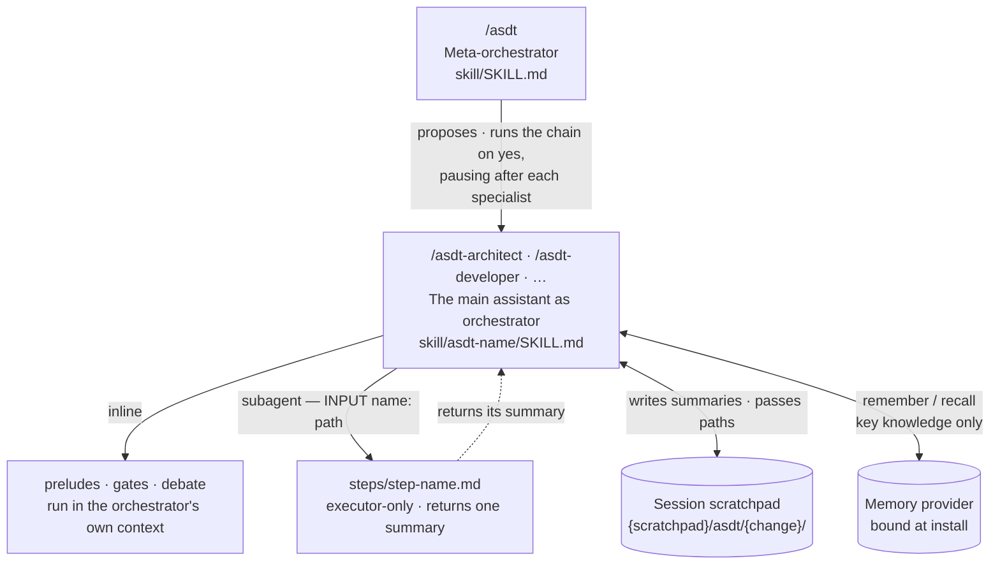

# ASDT Skills

This directory contains everything installed into the AI assistant. The Go binary (`asdt-tui`) copies these files into `~/.claude/skills/` (Claude Code) or `~/.config/opencode/skills/` (OpenCode) at install time.

## Three-Layer Execution Model



**Meta-orchestrator** (`skill/SKILL.md`) — the `/asdt` command. Reads the request and answers one of three ways: a specialist chain, a single specialist, or — when the question is about the STATE of the work — the answer itself, from the scratchpad, git, and a recall. On the user's yes it runs the chain one specialist at a time, pausing after each so the user can debate before the next one starts.

**The orchestrator** (`skill/asdt-{name}/SKILL.md`, read by the main assistant) — whoever runs, the main assistant orchestrates under the same rules: it converses with the user, decides, runs the gates, writes every working file, and alone remembers and recalls. It reads `workflow.yaml` and launches each `subagent` step as an isolated sub-agent; `inline` steps run in its own context.

**Step sub-agents** (`skill/asdt-{name}/steps/*.md`) — executor-only. Each does one step, reads the scratchpad paths it was handed and the codebase, and RETURNS a concise Markdown summary. It never reaches memory and writes nothing — except `developer/implement` (host code inside approved roots) and `asdt-init/write` (`.asdt/`). Steps never delegate further. No specialist requires another's work: every cross-specialist input is optional and degrades, which is what lets any of them run alone.

The full contract — ownership and authority, the scratchpad, memory, intake, the write boundary, injection — lives in `asdt-core/protocol.md`; the summary schema in `asdt-core/references/summary-schema.md`. It is the one shared skill every run loads.

## Working Files: the Session Scratchpad

The orchestrator writes each step's returned summary to the session scratchpad, never to the repository:

```
{scratchpad}/asdt/{change}/{role}.md          ← role summary (output: summary)
{scratchpad}/asdt/{change}/{role}/{step}.md   ← step payload, when a later step lists {role}/{step}
{scratchpad}/asdt/study-{topic}/{role}.md     ← a study (audit, review)

Examples:
  …/asdt/add-auth/architect.md
  …/asdt/add-auth/developer.md
  …/asdt/add-auth/developer/spec.md
```

`{scratchpad}` is the host's session scratchpad directory (Claude Code provides one), else `/tmp/asdt-{project}/{session}`, where `{project}` is the project's basename plus a short hash of its identity (so same-named repositories get separate scopes) and `{session}` is a fresh clock-based id, so a session never reads another's files (`asdt-core/protocol.md` §0, §1). A step receives each file as `### INPUT {name}: {path}` and reads it itself, which keeps the orchestrator's context small and survives compaction. The scratchpad is disposable: losing it is normal, and a run that needs a lost summary rebuilds it from git, recall, and the user's words, re-showing every consent gate.

## Memory: Long-Term Recall

Memory keeps only the project's KEY knowledge across sessions — non-obvious decisions, conclusions reached in debate, lessons, conventions the user states, audit outcomes — as concise, self-contained notes with a short subject; a newer note on a subject supersedes the older. Never summaries, plans, or payloads. It is context, never authority: what was built is git, what is approved is the user at the gate, project facts are `.asdt/config.yaml`. Without memory, ASDT still works within a session.

No prompt names a memory provider or its tools. The orchestrator-facing prompts speak two verbs — memory **remember** and **recall** — defined once in `asdt-core/protocol.md` §2. The binding lives in a `<!-- ASDT:GENERATED:memory-binding -->` region committed EMPTY in the three orchestrator-facing files that reach memory: `asdt-core/protocol.md` (and so every routed SKILL.md it is spliced into), `asdt-init/SKILL.md`, and the root `SKILL.md`. At install, the Go installer splices the selected provider's binding into each one — its name, its `memory.provider` config value, and the tool calls behind each verb — from the provider's `ProviderDescriptor` in `internal/installer/providers.go`. Engram is the only provider available today. Memory is optional: a **No memory** install (the zero `ProviderDescriptor`) binds no provider and splices the explicit no-provider body (`noProviderBinding`, opening **No memory provider bound.**) instead, which `protocol.md` §2 and `asdt-init/SKILL.md` read as memory unavailable. Sub-agents never see the memory binding or reach memory: the generated `asdt-analyst` / `asdt-builder` agents carry no binding region, the Claude Code agents' tool allowlist grants no memory tool, and the OpenCode agents' permission block denies every known provider's memory tools (`*_{tool}`: OpenCode hands MCP tools to subagents otherwise). No text the orchestrator injects into a sub-agent carries a binding (`protocol.md` §5); `asdt-init/write` receives `memory.provider` through its `asdt-init/clarify` payload instead. Never write a provider's name or tool names into a prompt — `TestPromptsAreProviderNeutral` (`internal/installer/memory_binding_test.go`) fails if one appears outside a binding region.

Code intelligence follows the same pattern for the sub-agents, which are its main users. `asdt-core/executor-header.md` defines six verbs — **explore**, **search**, **read**, **callers**, **callees**, **impact** — and when they apply: only on an indexed project (the platform block's `Tooling:` line, or with no platform block the provider's index marker at the repository root); otherwise grep and read. Its `<!-- ASDT:GENERATED:code-intel-binding -->` region, and the one in `asdt-init/SKILL.md` (enrichment calls **explore**), are committed EMPTY and bound at install from the selected `CodeIntelDescriptor` in `internal/installer/code_intel.go`: the provider's name, index marker, config value, and the tool behind each verb it serves. The generated Claude Code agents are granted that provider's read-only tools. Code intelligence is optional: a **No code intelligence** install (the zero `CodeIntelDescriptor`) splices a body opening **No code-intelligence provider bound.** and grants nothing. `asdt-init/explore` probes the bound index marker and `asdt-init/write` records `code_intelligence: {config value}`.

## Directory Structure

```
skill/
├── SKILL.md                    ← meta-orchestrator (/asdt)
├── TEMPLATE.md                 ← authoring contract for specialists (repo-only, not installed)
├── embedded.go                 ← go:embed — bundles this dir into the binary
├── asdt-{name}/                ← one directory per specialist
│   ├── SKILL.md                ← orchestration plan (spliced header + orchestration plan)
│   ├── workflow.yaml           ← step registry: name, execution mode, inputs, output
│   └── steps/                  ← sub-agent prompt files (one per subagent step)
│       └── {step-name}.md
├── asdt-core/                  ← the protocol and its optional references
│   ├── protocol.md             ← the one mandatory shared skill
│   ├── specialist-header.md    ← spliced into every routed SKILL.md at install time
│   ├── executor-header.md      ← baked into generated agent definitions
│   └── references/             ← opt-in criteria loaded per step
│       └── {reference}.md
└── asdt-init/                  ← project initializer (/asdt-init)
```

## Step Execution Modes

Every step in `workflow.yaml` has an `execution:` field:

| Mode | What it means | Writes the role summary? |
|---|---|---|
| `inline` | Runs in the orchestrator's context — a prelude that enriches the prompts after it, or a gate that pauses for the human | Only if it declares `output: summary` |
| `subagent` | Launched as an isolated sub-agent that returns one summary | Only if it declares `output: summary` |

**Inline steps** run in the orchestrator's own context, never as a sub-agent. Preludes (`knowledge-recall`, `platform-analysis`) name the reference they follow in `skill:`. Gates (the Developer's `approve` and `verify`) have no `skill:` — their contract is a section of the specialist's `SKILL.md`, and they re-launch only the sub-agent steps that section names. No inline step declares `inputs:`.

**Subagent steps** each declare:
- `inputs:` — scratchpad names: `{role}` (another specialist's role summary) or `{role}/{step}` (an earlier step of this specialist), injected as `### INPUT {name}: {path}`
- `output: summary` — optional: the step's return becomes the role summary
- `reference_skills:` — which shared skill files to load as guidelines
- `host_skills:` — optional: skills the host assistant may have installed (e.g. `frontend-design`), injected when present and skipped silently when not

The exact schema is `TEMPLATE.md` §3.

## Adding a New Specialist

`TEMPLATE.md` in this directory is the normative contract for the steps below — required frontmatter, the fixed `SKILL.md` body order, the step-file layout, the summary contract, and the registration mirrors. Read it before adding or normalizing a specialist. It is repo-only authoring guidance: `embedded.go` bundles `SKILL.md` and `asdt-*`, so nothing else at this level ships to user projects.

1. Create `skill/asdt-{name}/` with `SKILL.md`, `workflow.yaml`, and `steps/`
2. Add the `FIRST ACTION` blockquote and the empty generated region to `SKILL.md` — copy from any existing specialist
3. Declare each step in `workflow.yaml` with `execution:`, `inputs:`, and `output: summary` on the step whose return is the role summary
4. Write one `steps/{step-name}.md` per `subagent` step — the step file NEVER contains the EXECUTOR block. Those guardrails come from the agent definition (`agent: analyst` / `agent: builder`, which bake `asdt-core/executor-header.md` in) or, in every other case, from the orchestrator prepending that header to the sub-agent prompt. See `asdt-core/protocol.md` for which of the two applies
5. Register the specialist in the `Registry` section of `skill/SKILL.md`
